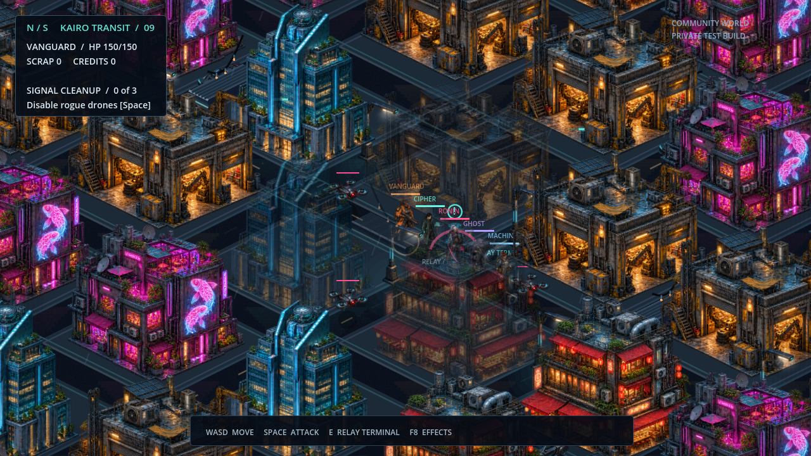
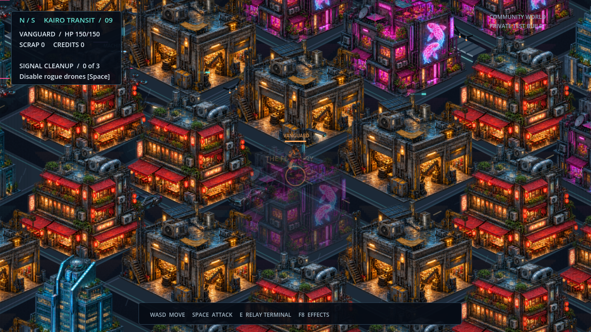
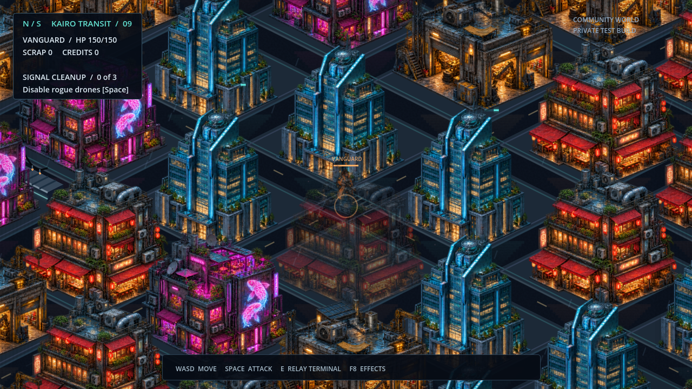

# Neon Shard · enclosed city

The city now fills the view with dense buildings and narrow streets. The broad open plaza has become a compact relay intersection, with skybridges and hanging service cables above the routes. Buildings continue beyond the playable boundary rather than exposing an empty edge.

These are **actual Godot renders** of a staged scene, not standalone concept images or a live multiplayer session.

## Enclosed relay district

[Open full-size city image](city.png) · [Effects reduced](city-low.png)

## Street and boundary views

[Open full-size alley image](city-alley.png)

[Open full-size boundary image](city-edge.png)

## Character selection

[Vanguard](class-vanguard.png) · [Cipher](class-cipher.png) · [Ronin](class-ronin.png) · [Ghost](class-ghost.png) · [Machinist](class-machinist.png)

## Compare earlier layouts

[Previous open layout with the same art](city-open-layout.png) · [Original city](city-before.png) · [Original character selection](character-selection-before.png)

Movement collision, street navigation, enemy pursuit, blocked attack sightlines, and saved-position migration were checked. Multiplayer combat, character slots and restart persistence passed the integration test in this enclosed layout.

The art is generated and integrated as 2D texture atlases. Overhead bridges are visual structures, not playable upper floors. Interiors, directional animation and crowds remain future work. These screenshots are not a hardware performance benchmark.

This branch publishes the gallery for review; the development project remains in the working environment.
