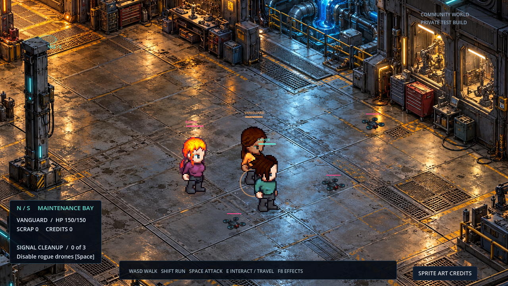
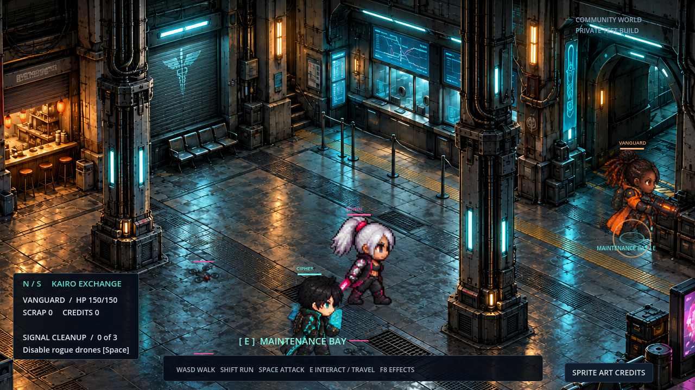
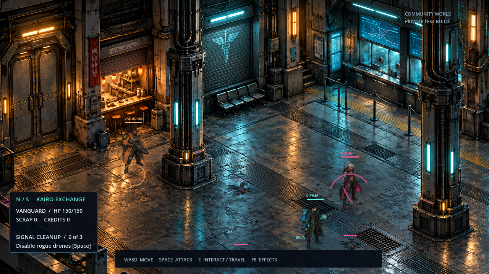
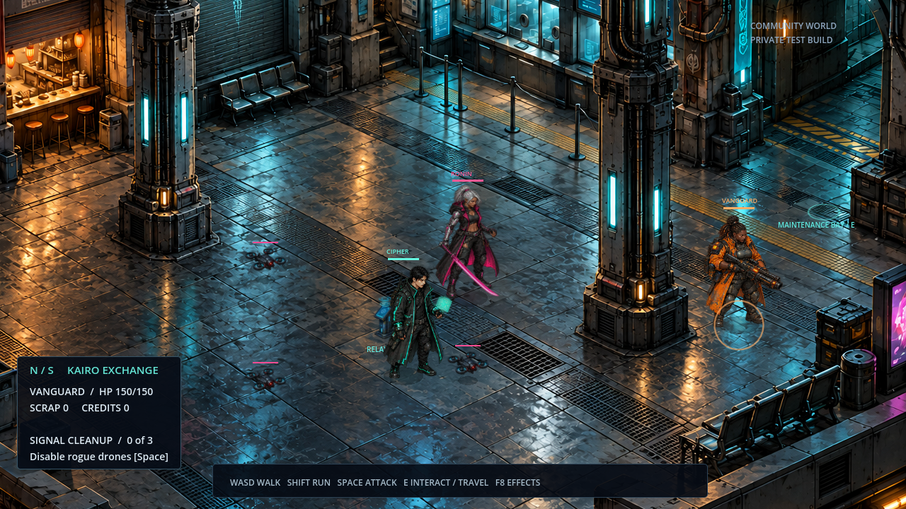
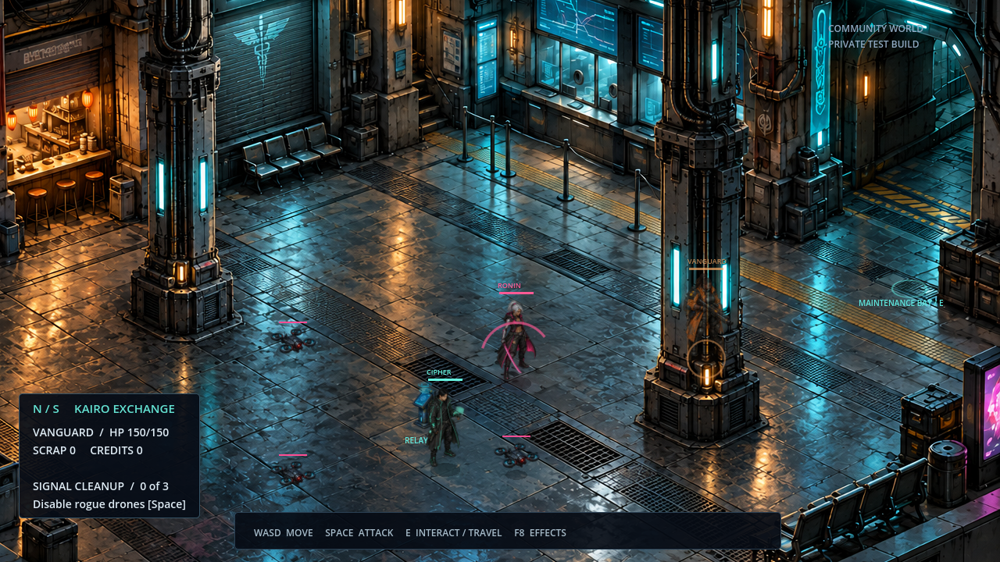
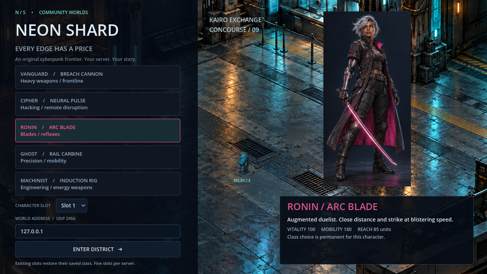

# Neon Shard · Connected interiors

The active areas are **Kairo Exchange and its connected Maintenance Bay**, with characters walking inside connected architecture. It replaces the repeated full-building layout with an authored floor, surrounding walls, recessed counters, structural columns, and foreground railings.

These are actual Godot renders with dynamic game actors. They are staged visual captures; real multiplayer combat and persistence were tested separately.

Characters are now **another 20% larger** (164.4 pixels tall), with matching foot shadows and selection rings, raised labels, and adjusted column fading. These previews show the updated scale in both rooms.

## Maintenance Bay

[Open full-size maintenance image](maintenance.png) · [Return doorway](maintenance-door.png) · [Column depth](maintenance-column.png)

Approach the marked doorway and press **E** to move between rooms. The bay has its own machinery, collision geometry and enemies.

[Open concourse travel view](concourse-travel.png)

## Inside the concourse

[Open the full-size interior image](interior.png) · [Added effects reduced](interior-low.png)

## Approaching the counter

[Open counter view](interior-counter.png)

## Connected room architecture

[Open doorway view](interior-doorway.png)

## Foreground depth

[Open column occlusion view](interior-occlusion.png)

Column footprints block movement and attacks. Their silhouettes are depth sorted with actors and partially fade over the local player when needed. The room camera stays within the artwork boundaries. Characters have foot shadows and move on the registered floor, rather than across an aerial view of roofs.

## Class selection

[Vanguard](class-vanguard.png) · [Cipher](class-cipher.png) · [Ronin](class-ronin.png) · [Ghost](class-ghost.png) · [Machinist](class-machinist.png)

## Previous layouts

[Previous repeated rooftop layout](city-rooftop-layout.png) · [Earlier open layout](city-open-layout.png) · [Original city](city-before.png)

## Current scope

These are two connected playable interiors, using original generated room paintings, registered collision geometry, and dynamic characters/enemies. It is not 3D geometry or a completed connected city. The marked connecting doorways work; shops and other painted doors remain environmental set dressing. Directional sprite animation and crowds remain future work.

Room collision, navigation around columns, enemy pursuit, blocked attacks, old-save relocation and camera bounds passed their checks. The real two-client integration test also passed movement, combat, mission rewards, character-slot persistence and server restart restoration, doorway travel, room isolation, maintenance combat, and return travel. Room, health and loot survived a server restart.

The screenshots are not a hardware performance benchmark. The complete playable project and Windows launcher are published on the repository’s main branch. See the root README for play instructions.
